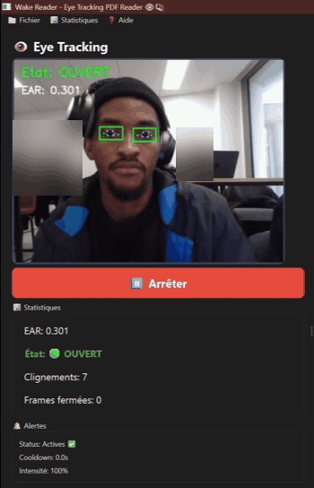
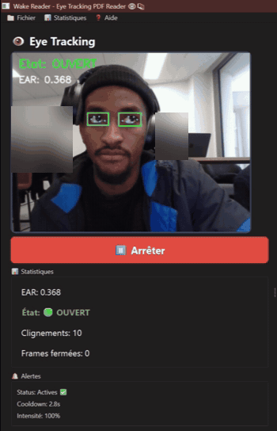
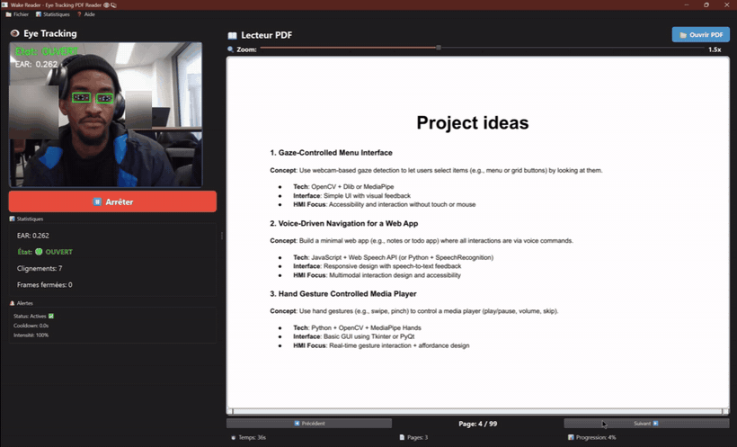
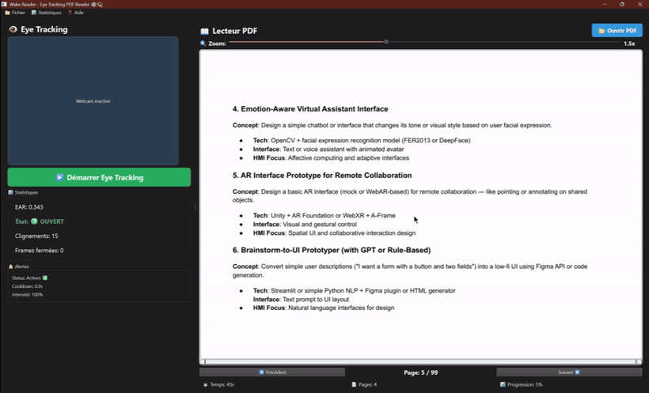

# BlinkGuard

[](https://github.com/GilDark012/BlinkGuard/actions/workflows/ci.yml)


A PDF reader that watches your eyes through the webcam and wakes you up with a sound alarm when you fall asleep or close your eyes while reading.

Started as the final project for the *Human Machine Interface* course (Aivancity, PGE-5).

## Demo

| Eye-closure detection | Progressive alarm |
|:---:|:---:|
|  |  |
| Face Mesh landmarks + Eye Aspect Ratio, live at 30 FPS | Eyes kept closed: the alarm rings, then rings again 20% louder (sped up ×2) |

**PDF reader**: page navigation, zoom and reading progress



**Session statistics**: reading time, blinks, alerts, attention score, CSV/JSON export



<sub>Demo recorded with desktop v1 (French UI).</sub>

## How it works

- **Eye tracking**: MediaPipe Face Mesh finds the eye landmarks and computes the **Eye Aspect Ratio (EAR)**. When the EAR stays below a threshold for about a second, the eyes count as closed.
- **Alerts**: an alarm rings for 5 s, then waits through a 10 s cooldown. If the eyes stay closed, each new alert is 20% louder than the last one. An alarm also goes off when the face leaves the camera for 5 s.
- **PDF reader**: open a PDF, move between pages, and zoom from 50% to 300%.
- **Statistics**: reading time, pages visited, blinks, an attention score, and export to CSV or JSON.

## Project status

| Version | Status |
|---|---|
| **Desktop v1** ([`desktop/`](desktop/)): Python, PyQt6 | Feature-frozen. Only bug fixes from now on. |
| **Web app**: runs entirely in the browser | In development (English UI with a French switch, local only for now) |

## Repository layout

| Path | Description |
|------|-------------|
| [`desktop/`](desktop/) | Desktop app v1 (PyQt6) with its tests |
| [`prototypes/`](prototypes/) | First standalone scripts: eye detection, then eye detection plus a sound alert |
| [`docs/demo/`](docs/demo/) | Demo GIFs used in this README |

## Quick start (desktop v1)

```bash
py -3.11 -m venv C:\venvs\blinkguard        # path without accents: MediaPipe needs it
C:\venvs\blinkguard\Scripts\activate
cd desktop
pip install -r requirements.txt
python main.py
```

You need Python 3.9–3.12, a webcam and working audio output. To run the tests: `pip install -r requirements-dev.txt`, then `python -m pytest`.

## Roadmap

- [x] Desktop v1: eye tracking, progressive alarm, face-lost alarm, PDF reader, statistics, tests
- [x] Continuous integration: lint and tests on every push
- [ ] Web app: in-browser face tracking, alarm and PDF reader, English and French
- [ ] Personal calibration of the eye-closure threshold
- [ ] Settings panel, gentler alert levels (visual first, then sound), snooze
- [ ] Session history with charts
- [ ] Accessibility (keyboard, contrast, screen readers)

## Privacy

Everything runs on your machine. No video is recorded and nothing is sent online.

BlinkGuard is a reading aid, not a medical device. It does not diagnose or prevent fatigue or sleep disorders.
